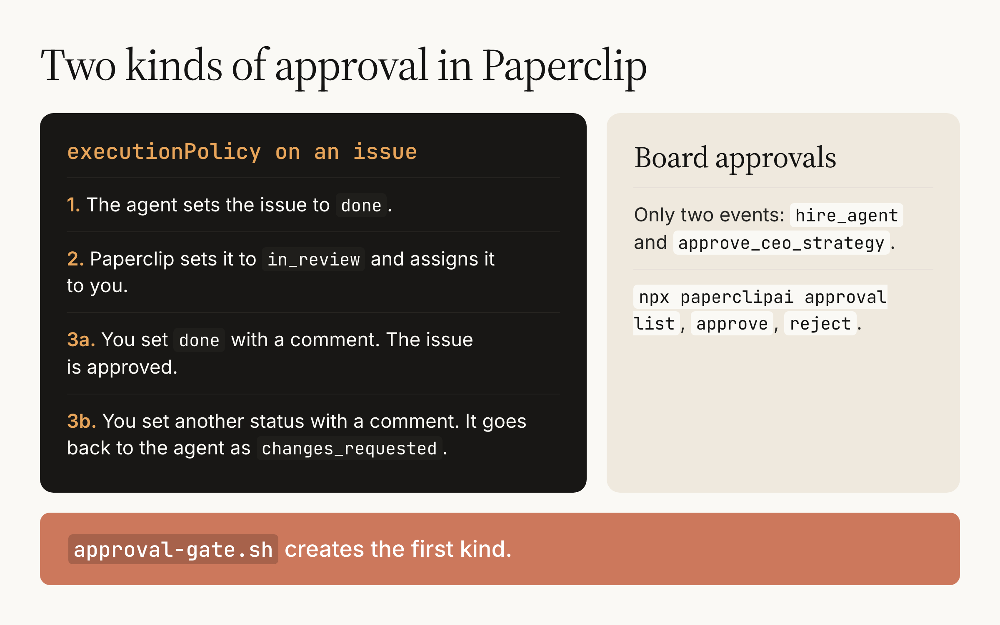

# Chapter 8: Hermes as a Paperclip employee

This is the chapter the book exists for, and the folder you'll come back to. Two agent configs and three scripts.

## The agent configs

| File | From chapter 8 | Paste into |
|---|---|---|
| `agents/hermes-engineer.json` | "The adapterConfig Schema", the adapter's documented default | Agents, Add Agent |
| `agents/research-worker.json` | "A complete example" | Agents, Add Agent |

Name and role have their own fields in the dashboard, adapter type is `hermes_local` from the dropdown, and the `adapterConfig` block goes in Adapter Config:

```bash
jq .adapterConfig chapters/08-compose/agents/research-worker.json
```

`hermes-engineer.json` keeps the book's `anthropic/claude-sonnet-4` and `persistSession: true`, because that's what the adapter's README prints. For an agent you actually run, do what the chapter says: set `model` to `anthropic/claude-sonnet-4-5` and `persistSession` to `false` until your first runs are clean (Paperclip issue #1160).

Check: `npx paperclipai agent list --company-id <company-id>` shows the agent. Then the build step: check out your chapter 7 issue for it and run one heartbeat.

## The scripts

`chain-path-b.sh` and `approval-gate.sh` also need the exports that `agent local-cli` prints; `chain-path-a.sh` needs only the ids:

```bash
npx paperclipai agent local-cli <agent-ref> -C <company-id> --no-install-skills
```

**Run two issues in order, CLI only** ("Sequencing a two-issue chain", path A):

```bash
chapters/08-compose/chain-path-a.sh <company-id> <agent-id> "Scaffold the API" "Add auth on top of the API"
```

Creates issue 1, runs a heartbeat, reads issue 1's status, and creates issue 2 only when issue 1 says `done`. If it doesn't, the script stops and tells you which issue to look at.

**Let Paperclip enforce the order** (path B, the blocker edge):

```bash
chapters/08-compose/chain-path-b.sh <company-id> <agent-id> "Scaffold the API" "Add auth on top of the API"
```

Creates both issues up front, issue 2 blocked by issue 1, prints the blocker it reads back, runs two heartbeats and prints both statuses. Success is both reading `done`.

Both ask you to type `yes` first: each heartbeat is a paid model run. Anything else, including no input at all, stops them before they create anything.

**Gate an issue behind your approval** ("Governance: Gating Sensitive Actions", mechanism 1):

```bash
chapters/08-compose/approval-gate.sh create <company-id> <agent-id> <board-user-id> "Send final report to client"
chapters/08-compose/approval-gate.sh approve <issue-id> "Approved. Send it."
```

`create` posts the issue with the `executionPolicy` approval stage. When the agent marks it done, Paperclip holds it in `in_review` and assigns it to you. `approve` sends `done` with your comment. It refuses an empty comment, since the server answers that with a 422.



## On your company

The ids come from your server: `agent list` for agent ids, the `id` field of an issue for issue ids. Issue identifiers on a live server carry your company's prefix, so the scripts use the ids Paperclip returns and never assume `PC-1`. Whether a single heartbeat finishes an issue depends on your agent and the task; the scripts read the status after each one rather than guess.
